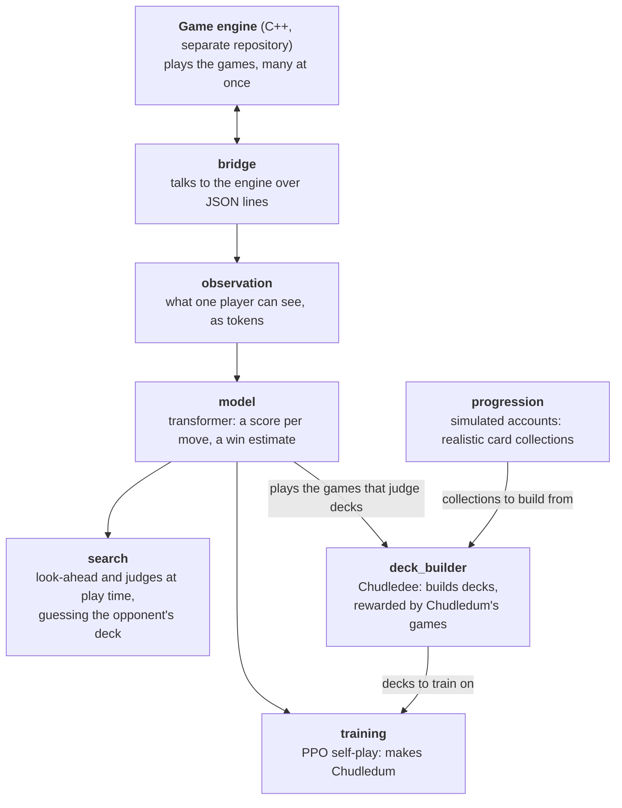

# AutoGITCG

Reinforcement-learning bots for **Genius Invokation TCG**, the card game in Genshin Impact.

> ## ▶ [Play against the bot in your browser](https://gitcg.merilas.com/join/3NH9YT)
>
> Bring your own deck and play a full game against Chudledum, the PvP network: **https://gitcg.merilas.com/join/3NH9YT**
> (the link carries the invite code `3NH9YT`). Nothing to install.

- **Chudledum** plays the game. One network handles both NPC fights (the opponent's deck is known) and blind PvP
  (only the board is visible). It is a transformer over the board, trained with PPO self-play, and can search ahead
  at play time.
- **Chudledee** builds decks from a card collection, one pick at a time, rewarded by how well Chudledum plays them.

The PvP network, **theta 1.13**, wins 69.4% of blind games against the earlier NPC bot (beta 10.8) on current
tournament decks, and 88.5% with its strongest search. Every trained network, with every 50-update milestone, is
published so you can try them. See [docs/results.md](docs/results.md).

## How it fits together



The folder names are the packages in `autogitcg/`.

| Doc | What it covers |
|---|---|
| [architecture.md](docs/architecture.md) | the engines, the bridge, what the network sees and outputs |
| [search.md](docs/search.md) | look-ahead, the named judges, guessing the opponent's deck |
| [training.md](docs/training.md) | how training works, the final settings, every attempt and what it taught |
| [deck-builder.md](docs/deck-builder.md) | Chudledee |
| [results.md](docs/results.md) | the measured results |
| [models.md](docs/models.md) | the trained networks and how to use them |
| [cloud-training.md](docs/cloud-training.md) | training on rented GPU machines |
| [experiments/](experiments) | ideas that were tried and dropped, and one-off investigations |

## Setup

Python 3.11 or newer, a C++23 compiler (GCC 16), Node.js 22 or newer for the one-time data export, and PyTorch (CPU is enough to play;
a GPU helps training).

```sh
git clone --recursive https://github.com/ValentineChuu/AutoGITCG   # --recursive also fetches the engine (engine/)
cd AutoGITCG                  # (already cloned without it: git submodule update --init)
python3 -m venv .venv && .venv/bin/pip install -e '.[training,analysis,dev]'

# The engine: build it; its JavaScript reference (Piovium's engine, patched, with our NPC-only characters) is also
# needed once, to export the card catalog this project reads
make -C engine -j8 build/release/worker
(cd engine && npm install && npm run build:data && node reference/tools/export_catalog.mjs)

# Game data: Dimbreath's tables and English text, the facts read from the card code, and a cross-check
.venv/bin/python scripts/data/fetch_dimbreath.py
.venv/bin/python scripts/data/export_entity_effects.py
.venv/bin/python scripts/data/audit_data.py

# Real tournament decks: every version for the locked test set and deck guessing, 6.4 on for PvP training
.venv/bin/python scripts/data/fetch_tournament_decks.py --versions 4-2 4-3 4-5 4-6 4-7 4-8 5-0 5-1 5-2 5-3 5-4 5-5 \
    5-6 5-8 6-0 6-1 6-2 6-3 6-4 6-5 6-6 6-7 7-0 7-1
```

Download the networks from the [releases page](https://github.com/ValentineChuu/AutoGITCG/releases) into `models/` ([docs/models.md](docs/models.md) says which
ones the tests need and how), then run the tests:

```sh
.venv/bin/python -m pytest tests experiments
```

## Try it

Theta 1.13 with the quick judge against plain beta 10.8, on current tournament decks:

```sh
.venv/bin/python scripts/evaluation/judge_duel.py \
    --first models/theta-1.13.pt --first-judge quick --second models/beta-10.8.pt --second-judge none \
    --benchmark meta --matchups 10 --output runs/duel/try
```

Each game is written as a readable move list (`runs/duel/try/games/*.txt`) and a replayable log. Other entry points:

| Script | What it does |
|---|---|
| `scripts/training/train.py` | train a combat network ([training.md](docs/training.md)) |
| `scripts/deck_builder/train_deck_builder.py` | train Chudledee |
| `scripts/deck_builder/build_deck.py` | show the decks Chudledee builds for a collection or a stage |
| `scripts/evaluation/test_lookahead.py` | a network with search against the plain network |
| `scripts/progression/run_progression_playthrough.py` | bots playing a simulated account through the whole game |
| `scripts/training/plot_training.py`, `analyze_games.py` | look inside a training run |

## Repository layout

| Path | Contents |
|---|---|
| `autogitcg/` | the Python package: bridge, observation, model, training, search, deck builder, progression, analysis |
| `engine/` | the game engine, [a separate repository](https://github.com/ValentineChuu/gitcg-engine-cpp) (submodule): the C++ engine, with its JavaScript reference in `engine/reference/` (Piovium pinned at 0.21.0, its patches, the worker and the custom NPC characters) |
| `scripts/` | command-line entry points, by area: `data/`, `training/`, `deck_builder/`, `evaluation/`, `progression/` |
| `experiments/` | dropped ideas and investigations, each with its own README |
| `data/` | the locked test sets (`benchmarks/`), the synergy decks (`decks/`) and the deck builder's decks the networks trained with (`training/`); downloaded and derived data are not tracked |
| `tests/`, `benchmarks/` | tests and throughput benchmarks |

## Thanks

- **Early testers**, who played the bot and told us what it did wrong: leoric, ChiKenz., Zenith, begula, TBlaze and raven.
- The [Genius Invokation TCG Discord server](https://discord.gg/BSeQFGdXe2), for letting us ask its members for testers.

## Credits

- The game rules are [Piovium's Genius Invokation engine](https://github.com/piovium/genius-invokation). The C++
  engine is a port of it.
- Game tables and text come from [Dimbreath's AnimeGameData](https://gitlab.com/Dimbreath/animegamedata2), downloaded
  on setup, not redistributed.
- Tournament decks and results come from the community's weekly tournament records at
  <https://gitcg-community.vercel.app>.
- Genius Invokation TCG and Genshin Impact are HoYoverse's. This is an unofficial fan project.

## License

AGPL-3.0 (see `LICENSE`). The C++ engine is a port of Piovium's AGPL-3.0 engine, so this project uses the same
license.
