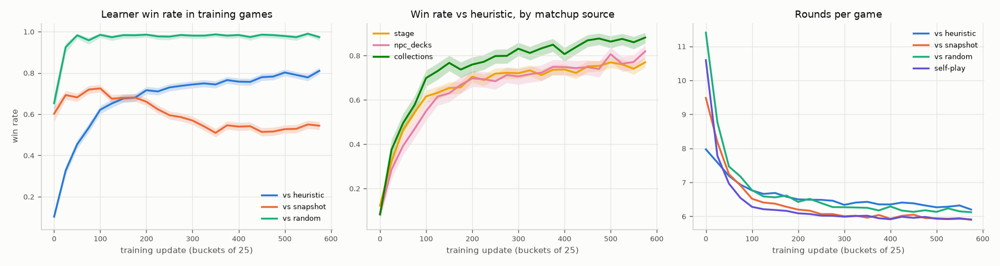
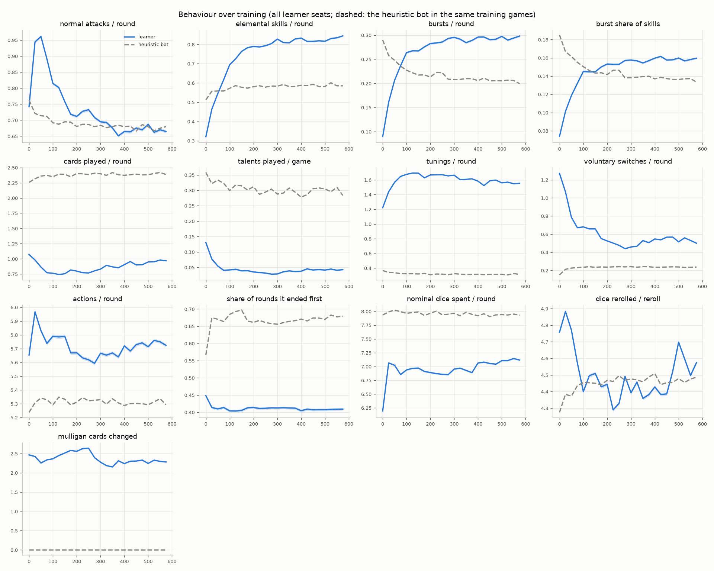
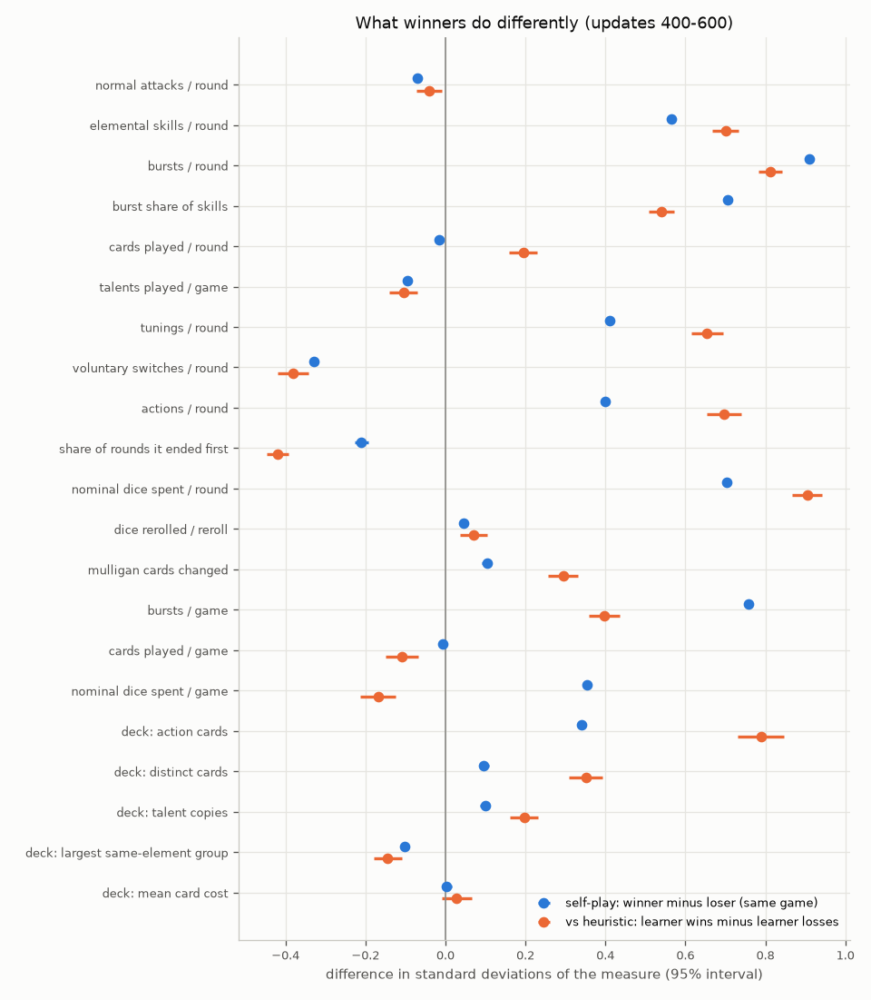
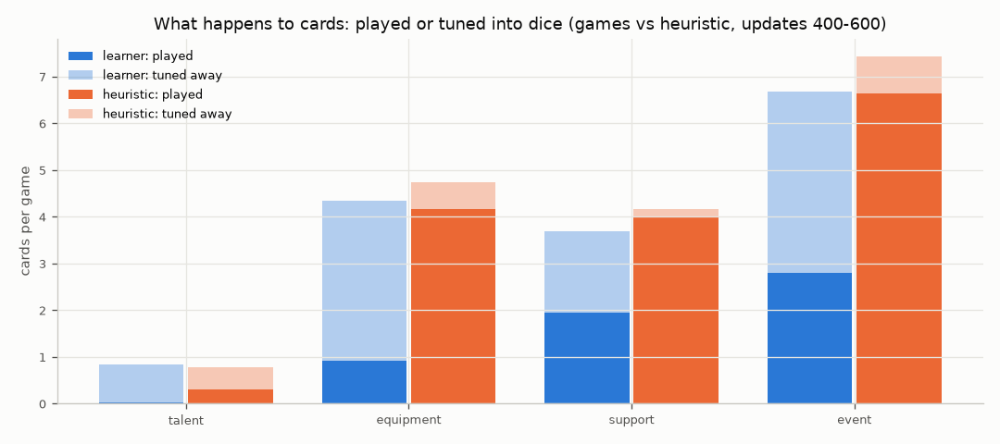
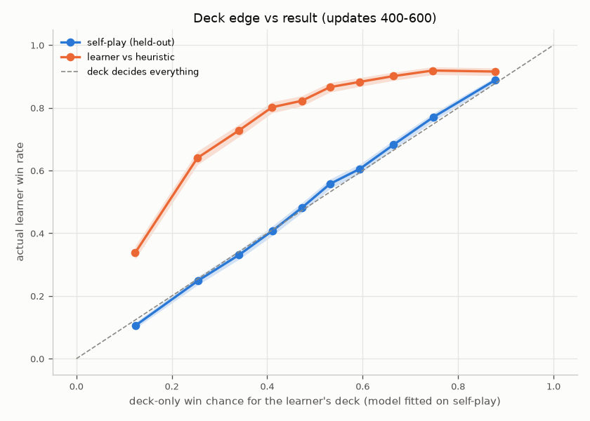
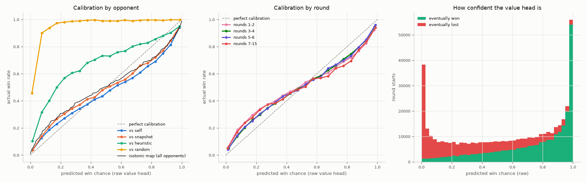
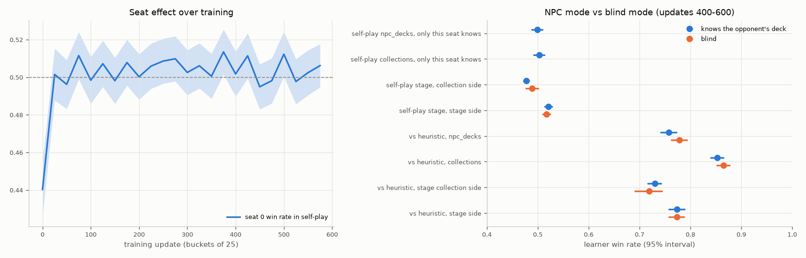

# What the bot has learned: statistics for `runs/alpha_01` (updates 0–600)

*Written 2026-10-13. Data: 279,573 training games, 25.7M moves, 433,989 learner seats. All figures and tables are regenerated by `experiments/early_run_reviews/review_alpha_1_statistics.py --run runs/alpha_01`. The complete set of generated tables is in [`figures/alpha_1/tables.md`](figures/alpha_1/tables.md).*

## Summary

1. **It wins by racing with skills.** Over training it went from mostly Normal Attacks to Elemental Skills (0.32 → 0.84 per round) and Bursts (0.09 → 0.30 per round). That is about 1.5× the heuristic's rate for both. Burst use is also the measure that best separates a winner from a loser of the same game.
2. **It throws most of its cards away.** Against the heuristic, it uses elemental tuning to turn 96% of its talent cards, 79% of its equipment and 58% of its event cards into dice. It plays 5.7 cards per game; the heuristic plays 15.1. This is the biggest behavioural difference between the two bots. The data can't tell whether more card play would win more often.
3. **The deck decides a lot.** Both seats in self-play run the same network, so only the decks and luck differ. A simple model that sees only the two decks picks the self-play winner 69% of the time.
4. **Most of the heuristic's remaining wins come from deck advantage.** 76% of the heuristic's wins happen when the learner holds the weaker deck. When the learner's deck is clearly weaker (deck-only win chance below 0.3; 19% of games), the heuristic wins half the time; otherwise it wins 14%. With even decks the learner wins about 84%.
5. **The hardest real-use case is invitation decks.** With a random collection deck against an invitation or Serious Showdown stage deck played well (by the network itself), the learner wins only 37–39%. When the heuristic plays the same decks, the learner wins 67–70%.
6. **Knowing the opponent's deck ("NPC mode") makes no measurable difference.** Every controlled comparison is within ±2 points, and none is statistically significant. The network doesn't appear to use that information yet.
7. **Seat barely matters.** In self-play, seat 0 wins 50.3% [49.9, 50.7] over updates 400–600.
8. **The win estimate (value head) is useful but biased.** It is overconfident at the extremes: a raw 2% means about 6%, and a raw 98% means about 93%. It also doesn't know who it is playing: against the heuristic it predicts 65% on average while it wins 75%, and against random it predicts 74% while it wins 97%. **A concede rule needs a calibration fitted per opponent type, on real games against the game's NPC AI.**
9. **About a third of games stay open to the end.** The outcome is "clear" (calibrated estimate stays above 0.8 or below 0.2) only around round 5 of about 6. In self-play, 8% of seats that fell to a 20% win chance or below still won.
10. **It is still improving against the heuristic** (0.70 → 0.81 in training games over updates 200–575). Its edge over its own past snapshots has settled at about 0.52–0.55. Its policy is still fairly uncertain: the chosen action has on average 50% probability, and mulligans are close to random.

## Terms used

- **Learner:** the network being trained. **Heuristic:** the scripted baseline bot (`policies/heuristic_policy.py`). **Snapshot:** an older saved copy of the network.
- **Value head / win estimate:** the network's own guess of its chance to win, shown here as a probability (raw output `v` in [-1, 1] → `(v+1)/2`).
- **Calibration:** whether a predicted "30%" really wins 30% of the time. **Isotonic recalibration** is a lookup table, learned from past games, that maps raw predictions to observed win rates.
- **Brier score:** the average squared error of a probability. 0.25 is what always saying 50% scores; lower is better. **AUC:** the chance that a random won game got a higher prediction than a random lost game. 0.5 means no skill, 1 means perfect.
- **Entropy:** how spread out the policy's choice is. 0 means certain; higher means more random. "Entropy / log(options)" is 1 for a uniform random choice.
- **Log-odds effect:** the unit of the deck model. +0.4 turns a 50% game into about 60%.
- **[a, b]:** a 95% confidence interval. **n:** the number of games or seats behind a number.
- **Updates 400–600** are called **"trained"**. The benchmark has plateaued by then, so most comparisons use these updates to avoid mixing in early, weaker play.

## Data and method

- Everything comes from `runs/alpha_01/games.sqlite`, read once into a per-seat cache (`data/derived/statistics_main_01.npz`, about 50 s to build). No rows are sampled; all games are used.
  - **Behaviour counts** come from every move.
  - **"Nominal dice spent"** sums the catalog cost of each skill or card played, plus 1 per switch. Discounts aren't logged.
  - **Card categories** (talent, equipment, support, event) come from the Piovium catalog.
  - **Skill types:** 1.3% of skill uses are card-granted skills absent from the catalog's character skills. They are counted as "other".
- **Which seat held the PvE stage deck** isn't logged. It was recovered by matching each deck exactly against the stage catalog's enemy decks. Exactly one side matched in all 140,161 stage games.
- **Stage groups:** many stages share an enemy deck (most weekly guests reuse invitation decks), so each deck gets one group by precedence: Serious Showdown (talent pre-equipped) > tavern > ascension > invitation > weekly guest > open world.
- **Value-head analyses** use one point per learner seat per round start (the seat's first decision of the round, from round 1). The isotonic map is fitted on even-numbered games and every score is computed on odd-numbered games.
- **Deck-only model:** a regularized logistic regression on self-play games, updates 300–600 (`autogitcg/analysis/deck_strength_model.py`).
  - Inputs: own lineup and card copies minus the opponent's, plus seat.
  - Fitted on even-numbered games, scored on odd-numbered ones.
  - Both seats run the same network, so the model measures deck strength rather than play quality.
- **Causality:**
  - Seat, deck knowledge and (largely) deck contents are randomized by the matchup sampler, so those comparisons are causal.
  - Everything about behaviour in wins vs losses is correlation: a winner's characters survive longer, so it gets more turns to Burst.

## 1. How its play changed over training



- **Win rate against the heuristic** in training games rose steadily: about 0.62 by update 100, 0.72 at 200, about 0.81 at 575. Collection-deck games are highest (0.88 late); stage and NPC-deck games reach about 0.77–0.82.
- **Win rate against its own snapshots** peaked at about 0.72 near update 100 and fell to about 0.52–0.55. That is expected once the snapshots it faces are only slightly older than itself.
- **Games got shorter:** from 8–11 rounds to about 6. Round-limit games fell to 0.2%.



| Per learner seat (means) | updates 0–24 | 100–124 | 300–324 | 575–600 | heuristic, same late games |
|---|---|---|---|---|---|
| Normal Attacks / round | 0.74 | 0.81 | 0.70 | 0.67 | 0.68 |
| Elemental Skills / round | 0.32 | 0.69 | 0.83 | 0.84 | 0.58 |
| Bursts / round | 0.09 | 0.26 | 0.30 | 0.30 | 0.20 |
| Cards played / round | 1.07 | 0.76 | 0.83 | 0.97 | 2.39 |
| Talents played / game | 0.13 | 0.04 | 0.03 | 0.04 | 0.29 |
| Elemental tunings / round | 1.22 | 1.68 | 1.66 | 1.55 | 0.32 |
| Voluntary switches / round | 1.27 | 0.68 | 0.46 | 0.50 | 0.24 |
| Share of rounds it declared end first | 0.45 | 0.40 | 0.41 | 0.41 | 0.68 |
| Nominal dice spent / round | 6.19 | 6.94 | 6.95 | 7.12 | 7.94 |
| Dice rerolled per reroll | 4.76 | 4.40 | 4.39 | 4.57 | 4.49 |
| Cards changed at mulligan (of 5) | 2.46 | 2.36 | 2.27 | 2.28 | 0 (never) |

n = 11,202 / 17,651 / 18,909 / 19,018 learner seats per column; 2,484 heuristic seats. Every per-round mean has a 95% interval narrower than ±0.02.

**What it learned:**
- It stopped wasting actions. Voluntary switches fell from 1.27 to about 0.5 per round, and the early spike in Normal Attacks faded.
- It now spends its dice on Elemental Skills and Bursts.
- To afford those skills it tunes cards into dice at about five times the heuristic's rate.

**What it did not learn:**
- Talent cards are almost never played (0.04 per game, down from 0.13 at random initialisation).
- Card play overall stayed at about one card per round, against the heuristic's 2.4.
- The mulligan changed little over training (see below).

The learner declares end first in 41% of rounds and the heuristic in 68%. The heuristic ends as soon as it has nothing it likes; the learner keeps acting, at 5.7 actions per round against 5.3.

| Policy confidence | updates 0–24 | 575–600 |
|---|---|---|
| Action: mean probability of the chosen option | 0.25 | 0.50 |
| Action: entropy / log(options), where 1 = uniform | 0.97 | 0.59 |
| Choose-active (after a defeat): mean probability | 0.53 | 0.81 |
| Reroll: summed entropy over 8 dice (max 5.5 nats) | 5.34 | 3.81 |
| Mulligan: summed entropy over 5 cards (max 3.47 nats) | 3.31 | 2.98 |

- **Action choice** is still far from deterministic, and it was still sharpening at update 600.
- **The reroll** has partly converged.
- **The mulligan is close to a coin flip per card:** 86% of maximum entropy. It changes about 2.3 of 5 cards whatever the hand. Either the mulligan carries little learning signal, or it really matters little.

## 2. What winners do differently



Two comparisons, both over updates 400–600:

1. **Self-play, paired.** The winner and loser of the same game run the same network, so policy quality is held fixed. 54,047 decided games.
2. **Against the heuristic.** The learner's own wins (15,349) compared with its own losses (4,271).

| Measure | self-play winner | self-play loser | paired difference | learner wins vs heuristic | learner losses | difference |
|---|---|---|---|---|---|---|
| Bursts / round | 0.36 | 0.21 | +0.14 ± 0.00 | 0.37 | 0.24 | +0.13 ± 0.00 |
| Elemental Skills / round | 0.92 | 0.73 | +0.19 ± 0.00 | 0.89 | 0.66 | +0.23 ± 0.01 |
| Normal Attacks / round | 0.65 | 0.68 | −0.02 | 0.69 | 0.70 | −0.01 |
| Tunings / round | 1.67 | 1.45 | +0.22 ± 0.01 | 1.67 | 1.32 | +0.35 ± 0.02 |
| Voluntary switches / round | 0.47 | 0.62 | −0.15 ± 0.00 | 0.47 | 0.65 | −0.18 ± 0.02 |
| Cards played / round | 0.95 | 0.96 | −0.01 ± 0.01 | 0.91 | 0.80 | +0.11 ± 0.02 |
| Share of rounds it ended first | 0.42 | 0.47 | −0.06 | 0.19 | 0.31 | −0.11 ± 0.01 |
| Nominal dice spent / round | 7.45 | 6.67 | +0.78 ± 0.01 | 7.43 | 6.43 | +1.00 ± 0.04 |
| Deck: action cards (out of 30) | 29.84 | 27.85 | +1.98 ± 0.07 | 29.79 | 25.20 | +4.59 ± 0.33 |
| Deck: talent copies | 1.72 | 1.59 | +0.13 ± 0.02 | 1.71 | 1.45 | +0.26 ± 0.05 |

**Reading:**
- **Winners spend more dice per round, mostly on Elemental Skills and Bursts.** They switch less and end the round first less often.
  - Much of this is a consequence of being ahead: a side that isn't losing characters doesn't need to switch, and keeps the energy and dice to Burst.
  - It is still consistent with "spend everything on damage every round", which is the style the learner adopted.
- **Cards played per round barely separates winners from losers in self-play** (−0.01). So within the learner's own style, playing more or fewer cards isn't what decides games. That doesn't show more card play would be useless; the learner hardly varies its card play.
- **Deck size matters.** PvE stage decks (often 0 action cards, 1, 2 or 4 characters) lose far more often; see section 4. Talent copies in the deck help a little even though the talent is almost never played. A talent can be tuned like any other card, so it may simply stand in for a stronger lineup.

## 3. Cards: played or turned into dice



In the 19,620 games against the heuristic (updates 400–600), per game:

| Card category | learner played | learner tuned | learner share played | heuristic played | heuristic tuned | heuristic share played |
|---|---|---|---|---|---|---|
| Talent | 0.03 | 0.81 | **0.04** | 0.30 | 0.48 | 0.38 |
| Equipment (weapons, artifacts) | 0.92 | 3.42 | **0.21** | 4.16 | 0.57 | 0.88 |
| Support (companions, locations, items) | 1.94 | 1.75 | 0.53 | 4.01 | 0.14 | 0.97 |
| Event (including food and resonance) | 2.81 | 3.87 | 0.42 | 6.64 | 0.79 | 0.89 |

- **Cards the learner does play:**
  - cheap or free cards with an immediate payoff: Favonius Cathedral 97%, Vanarana 93%, Knights of Favonius Library 90%, The Bestest Travel Companion! 88%;
  - resonance events, 83–87%.
- **Cards it almost always tunes away:**
  - nearly every talent (Chaotic Entropy, Stellar Predator, Flowing Flame: 0–2%);
  - weapons and artifacts such as Beacon of the Reed Sea (3%);
  - situational events such as Master of Weaponry (0%) and Guardian's Oath (1%; the heuristic plays it 65% of the time).
  - The full lists are in `tables.md`.

**Interpretation (hypothesis, not proven):**
- The policy has learned that a die now is worth more than an equipment card's payoff later.
- With games of about 6 rounds that may be partly right, but the deck model (section 4) says some of these cards do win games in self-play.
- The learner may simply not have learned their value yet. Card effects are rarer and more delayed than skill effects, so they are harder to credit with the ±1 end-of-game reward.
- **This is the clearest place where play can improve.**

## 4. Deck vs play: how much the deck decides

| Predictor of the self-play winner (40,392 held-out games) | log loss | Brier | accuracy | AUC |
|---|---|---|---|---|
| Always the average | 0.693 | 0.250 | 0.507 | 0.500 |
| **Deck-only model** (characters + cards + seat) | **0.576** | **0.197** | **0.694** | **0.765** |
| Value head at the mulligan (round 0) | 0.612 | 0.210 | 0.673 | 0.747 |
| Value head at start of round 1 | 0.616 | 0.212 | 0.672 | 0.749 |
| Value head at start of round 3 | 0.556 | 0.186 | 0.722 | 0.807 |
| Value head at start of round 5 | 0.422 | 0.134 | 0.808 | 0.898 |

- **Decks alone predict 69% of self-play results.** The model cuts the uncertainty (log loss) by 17% relative to a coin flip.
- **The value head at the start of the game is worse than this simple linear deck model,** even though it sees both lineups (and the opponent's cards in NPC mode). It only overtakes the deck model around round 3. This is a concrete sign that the value head underuses deck information.



**Against the heuristic**, grouped by how good the learner's deck is (deck-only win chance, 10 groups of about 2,000 games):

| Learner deck chance | 0.01–0.20 | 0.20–0.30 | 0.30–0.38 | 0.38–0.44 | 0.44–0.50 | 0.50–0.56 | 0.56–0.63 | 0.63–0.70 | 0.70–0.80 | 0.80–0.99 |
|---|---|---|---|---|---|---|---|---|---|---|
| Learner win rate | 0.34 | 0.64 | 0.73 | 0.80 | 0.82 | 0.87 | 0.88 | 0.90 | 0.92 | 0.92 |

- **Better play is worth roughly +35 points** at even decks: about 0.84, where the self-play curve gives 0.5. It is still worth +22 points with a badly losing deck.
- **The learner's win rate tops out at about 0.92 even with a very strong deck.** The other 8% are losses it should probably not have, and they are worth examining in replays.

**Deck features** (learner win rate, updates 400–600; full table in `tables.md`):
- **PvE decks:** with no action cards the learner wins 0.13 against the heuristic (n=789) and 0.07 in self-play (n=4,176).
- **Lineups of 3 different elements:** 0.526 in self-play (n=65,958).
- **Lineups where two characters share an element:** 0.487 (n=38,712).
- **Single-element lineups:** 0.21 (n=694). These are rare and come mostly from stage decks, so this is confounded.
- **Strongest characters** (log-odds, with deck counts): Cyno +0.63 (1,135), Qiqi +0.55 (684), Fischl +0.54 (9,436), Ganyu +0.50 (1,191), Stonehide Lawachurl +0.49 (481).
- **Weakest characters:** Mavuika −0.62 (310), Maguu Kenki −0.48 (400), Chasca −0.39 (344), Xianyun −0.38 (361), Xingqiu −0.37 (2,069).
- **Strongest cards, per copy:** Undivided Heart, Vanarana, Rainbow Macarons, the Woven Weeds and Woven Stone resonances, and Nasha Town (+0.22 to +0.29).
- **Caveats on these rankings:**
  - They are relative to *how this network plays*. A character whose talent it never plays is under-rated.
  - NPC characters always come with their fixed deck, so their effect includes that deck.

## 5. PvE stages: the real use case

**The learner holds a random collection deck against a stage deck** (updates 400–600):

| Stage group | Stage deck played by the heuristic | Played by the learner itself | Played by a snapshot |
|---|---|---|---|
| Serious Showdown | 0.671 [0.624, 0.714] (n=416) | **0.369** [0.350, 0.388] (n=2,445) | 0.362 (n=459) |
| Invitation | 0.703 [0.687, 0.718] (n=3,300) | **0.393** [0.386, 0.400] (n=18,834) | 0.445 (n=3,432) |
| Open world | 0.770 (n=274) | 0.724 (n=1,339) | 0.739 (n=245) |
| Tavern | 0.756 (n=320) | 0.791 (n=1,966) | 0.825 (n=342) |
| Weekly guest | 0.896 (n=471) | 0.855 (n=2,429) | 0.868 (n=441) |
| Ascension | 0.885 (n=26) | 0.978 (n=91) | 1.000 (n=13) |

- **Invitation and Serious Showdown decks** are coherent character-card decks. A random collection deck loses to them about 60% of the time when they are played well.
- **The stage results depend heavily on how well the stage deck is played.** The game's own NPC AI is probably somewhere between the heuristic and the network, but that is untested: no game against the real AI is in this data.
- **Tavern, weekly-guest, open-world and ascension decks are easier.** Many have no action cards or 1, 2 or 4 characters.
- **Hardest stage lineups** for the learner (collection deck, at least 150 games each, 97 lineups qualify; overall 0.517 over 36,843 games):

  | Stage lineup | Learner win rate | Games |
  |---|---|---|
  | Escoffier / Furina / Candace | 0.105 | 257 |
  | Sigewinne / Qiqi / Neuvillette | 0.121 | 265 |
  | Ineffa / Cyno / Mona | 0.121 | 314 |
  | Ganyu / Diona / Keqing | 0.155 | 283 |
  | Charlotte / Barbara / Qiqi | 0.161 | 279 |

  These are mostly healing and Hydro/Cryo control decks. Even when the heuristic plays them, the learner wins only 9–22% (n of about 35 each).

## 6. When games are decided

Using the learner's calibrated win estimate at each round start (held-out games, updates 400–600):

| Matchup | seats | rounds | decided round | never clear before the end | comeback rate (was ≤ 0.2) | collapse rate (was ≥ 0.8) |
|---|---|---|---|---|---|---|
| Collections, self-play | 13,734 | 5.56 | 4.97 | 0.36 | 0.079 (n=4,704) | 0.142 (n=5,797) |
| NPC decks, self-play | 13,352 | 6.35 | 5.59 | 0.37 | 0.089 (n=4,631) | 0.140 (n=5,357) |
| Stage, self-play, collection side | 13,480 | 5.92 | 4.72 | 0.31 | 0.072 (n=5,289) | 0.116 (n=5,475) |
| Collections vs heuristic | 2,493 | 5.92 | 4.82 | 0.29 | 0.317 (n=252) | 0.054 (n=1,830) |
| NPC decks vs heuristic | 2,487 | 6.77 | 5.67 | 0.33 | 0.233 (n=442) | 0.079 (n=1,578) |
| Stage vs heuristic, collection side | 2,389 | 6.38 | 5.23 | 0.32 | 0.241 (n=498) | 0.091 (n=1,497) |

- **"Decided round"** is the first round start from which the estimate stays at or above 0.8 (for a win) or at or below 0.2 (for a loss) until the end.
- **Games are typically decided only 1–2 rounds before they end,** and about a third are never clear before the final round. GITCG games are swingy, with few early knockouts.
- **The average win estimate separates wins from losses from round 1,** at about 0.61–0.65 against 0.41–0.46, and the gap widens steadily. There is no single turning-point round.
- **Comebacks against the heuristic (23–32%) look high** only because the shared calibration under-rates the learner against the heuristic (section 7). In self-play, comebacks from 20% or below happen 7–9% of the time.
- **Collapses (being at 80% or more and losing) happen in 12–14% of self-play seats.** That is a little more often than calibration predicts, because these are the minimum or maximum over several rounds.

## 7. How far to trust the win estimate (value head), and the concede rule



| Held-out round starts | n | mean predicted | actual | Brier raw → calibrated | calibration error raw → calibrated | AUC |
|---|---|---|---|---|---|---|
| All | 456,784 | 0.560 | 0.552 | 0.166 → 0.162 | 0.058 → 0.002 | 0.839 |
| vs self | 320,532 | 0.536 | 0.498 | 0.169 → 0.165 | 0.063 → 0.034 | 0.839 |
| vs snapshot | 58,910 | 0.546 | 0.529 | 0.166 → 0.162 | 0.057 → 0.012 | 0.842 |
| vs heuristic | 62,220 | **0.652** | **0.750** | 0.160 → 0.155 | 0.119 → 0.120 | 0.813 |
| vs random | 15,122 | **0.744** | **0.969** | 0.131 → 0.127 | 0.225 → 0.253 | 0.947 |
| Stage, learner holds the collection deck | 113,163 | 0.539 | 0.521 | 0.162 → 0.157 | 0.059 → 0.020 | 0.852 |
| Rounds 1–2 | 152,466 | 0.564 | 0.555 | 0.206 | 0.070 | 0.750 |
| Rounds 5–6 | 111,443 | 0.559 | 0.554 | 0.127 | 0.047 | 0.905 |

**Isotonic map (raw → observed):** 0.02 → 0.06, 0.05 → 0.12, 0.10 → 0.20, 0.50 → 0.51, 0.90 → 0.81, 0.95 → 0.87, 0.98 → 0.93.

- **Overconfident at both ends,** the same at every round (middle panel). This confirms the earlier finding. One monotone map fixes the overall calibration: error 0.058 → 0.002.
- **Opponent-blind.** The network can't see who it's playing, so its estimate is roughly "chance against an opponent like me".
  - Against the heuristic, a raw 25% actually wins about 57%.
  - Against random, a raw 2% still wins 45%.
  - In self-play both seats are slightly optimistic: 0.536 predicted on average against 0.498 actual.
- **It ranks positions well** (AUC 0.84 overall, 0.90 by rounds 5–6), but the probability level depends on the opponent.

**What a concede rule would have done** (held-out games; chance from the shared calibration, checked at each round start):

| Population | concede when chance < | games conceded | win rate of conceded games | share of all wins thrown away | rounds saved per concession |
|---|---|---|---|---|---|
| Stage, collection side (not vs random), 18,310 games | 0.05 | 19.2% | 1.5% | 0.5% | 1.9 |
| | 0.10 | 27.4% | 3.9% | 2.0% | 2.4 |
| vs heuristic, 9,859 games | 0.05 | 8.3% | 5.8% | 0.6% | 3.3 |
| | 0.10 | 11.7% | 11.4% | 1.7% | 3.7 |
| Self-play, 54,046 games | 0.05 | 18.7% | 1.6% | 0.6% | 2.2 |

- **Against network-strength opponents,** a 5% threshold gives up only about 0.5% of wins and saves about 2 rounds in the roughly 19% of games it concedes.
- **Against a weaker opponent (the heuristic),** the conceded games win about 6% at the 5% threshold. The map isn't badly off there, but at 10% they already win 11%.
- **Implication:** the concede rule's calibration must be fitted on games against the opponent it will actually face. That is the real NPC AI, so log the first real or simulated PvE games for it. The calibration should also be refitted for each new network.

## 8. Seat effect and NPC mode vs blind mode



**Seat** (updates 400–600):
- Self-play, seat 0 win rate: 0.503 [0.499, 0.507] (n=54,147).
  - By source: stage 0.501, NPC decks 0.498, collections 0.512 [0.503, 0.520].
- Against the heuristic: learner in seat 0 wins 0.779, in seat 1 0.786 (about 9,800 games each).
- **No meaningful seat effect.** The progress log's 50.5% was an all-updates figure; early training contributes a seat-1 edge (see the figure).

**Deck knowledge.** Knowledge is randomized, so these comparisons are causal. They are made within one source and side, because stage games give the collection side 80% knowledge and the stage side 50%; pooling would mix in the side's own win rate.

| Learner seats (updates 400–600) | knows the deck | blind | difference |
|---|---|---|---|
| Self-play NPC decks, only this seat knows | 0.499 [0.487, 0.511] (n=6,756) | — | — |
| Self-play collections, only this seat knows | 0.503 [0.491, 0.515] (n=6,796) | — | — |
| Self-play stage, collection side | 0.477 (n=21,624) | 0.489 (n=5,480) | −0.012 ± 0.015 |
| vs heuristic, NPC decks | 0.757 (n=2,478) | 0.778 (n=2,472) | −0.020 ± 0.024 |
| vs heuristic, collections | 0.853 (n=2,478) | 0.865 (n=2,483) | −0.012 ± 0.019 |
| vs heuristic, stage collection side | 0.730 (n=3,816) | 0.718 (n=991) | +0.011 ± 0.031 |

- **No detectable benefit from seeing the opponent's deck.** Any effect is below about 2 points.
- The value head is barely sharper with the information: AUC 0.843 with it against 0.833 blind.
- **Either the network ignores the opponent-deck tokens, or the information isn't worth much at this skill level.** Seeing what the opponent can still draw matters most for planning several turns ahead, and the learner doesn't plan that far yet.

## 9. Against the heuristic: what still beats the bot

Over updates 400–600 the heuristic won 4,200 of 19,620 games (21.4%).

| Measure | heuristic, its wins | heuristic, its losses | learner, in those heuristic wins | learner, in its own wins |
|---|---|---|---|---|
| Bursts / game | 2.08 | 1.17 | 1.73 | 2.21 |
| Bursts / round | 0.29 | 0.18 | 0.23 | 0.37 |
| Elemental Skills / round | 0.61 | 0.58 | 0.66 | 0.89 |
| Cards played / round | 2.43 | 2.38 | 0.80 | 0.91 |
| Talents played / game | 0.36 | 0.28 | 0.05 | 0.03 |
| Voluntary switches / round | 0.21 | 0.24 | 0.64 | 0.47 |
| Characters lost | 0.94 | 2.97 | 2.93 | 1.09 |

- **The heuristic doesn't win with a different style.** Its wins look like its losses (same card play, same skill mix) except that it Bursts more. That reflects having characters alive and energy to spend, so its wins come from game state rather than better decisions.
- **Deck advantage is the main driver.**
  - The learner's deck was the weaker one (deck chance < 0.5) in 50% of games but 76% of heuristic wins.
  - When the learner's deck chance is below 0.2 (10% of games), the heuristic wins 66% [64, 68]; otherwise 17%.
- **In the heuristic's wins, the learner switches more** (0.64 against 0.47 per round) **and uses fewer Elemental Skills** (0.66 against 0.89). That fits being forced off a falling character, and dice going to switches instead of damage.
- **Many losses are surprises.** In 37% of its losses the learner still rated itself ahead (calibrated, at or above 0.5) at round 1; in 41%, at round 3. Calibration under-rates the learner against the heuristic, so the real share is probably a bit lower. Even so, many losses aren't foreseen.

## Implications for training (suggestions)

These are suggestions drawn from the data, not tested changes.

1. **Investigate card play first.**
   - The learner tunes away most equipment and nearly all talents.
   - **Cheap test:** a fixed-network experiment with a "play a card when the network's top action is a tuning of a playable equipment/talent" override, against the heuristic and snapshots. If it wins more, card play is under-learned.
   - **Possible remedies:**
     - a short behaviour-cloning warm start of the card decisions from the heuristic, or a KL-to-heuristic bonus that decays;
     - more PPO epochs, since the KL early stop currently halves them;
     - richer card features in the catalog projection.
2. **Make the benchmark deck-controlled.**
   - The deck explains much of the result, so a fixed benchmark of 200 games is noisy.
   - Play each benchmark matchup twice with decks swapped (a "mirror pair"). This cancels the deck and isolates play quality.
   - Report win rate by deck-edge bin, as in section 4.
3. **Oversample the hard, realistic matchups:** collection deck against invitation and Serious Showdown stage decks, where the learner wins 37–39%. These are the progression simulator's real blockers. Prioritized matchup sampling would weight sources by how much the learner still loses there.
4. **Check that the opponent-deck input is reaching the model.** NPC mode shows no benefit. Before adding more NPC-mode training, check with probe states that the policy and value outputs change when the opponent deck tokens are masked. If they don't, the information isn't reaching the model.
5. **Improve the start-of-game value.** A linear deck model beats the value head at round 0–1. An auxiliary "deck matchup" target, or simply more value-head capacity or training on early-game states, may help. That matters for the planned deck builder, which will need a good deck-vs-deck estimate.
6. **Concede rule:**
   - Keep it outside training, as decided.
   - Fit the isotonic map per opponent type on real NPC-AI games.
   - Start with a threshold of about 0.05: against network-strength opponents that loses only about 0.5% of wins and saves about 2 rounds per concession.
   - Never reuse a map fitted against one opponent for another; against random play the same raw numbers mean something completely different.
7. **Mulligan and reroll** are close to random or only partly learned. They are low priority, but if card play improves, the mulligan should start to matter. Watch its entropy.

## Caveats and data-quality notes

- **Which seat held the stage deck** is inferred by exact deck matching. It matched in all 140,161 stage games. Stage *groups* are heuristic labels, because one enemy deck can be used by several stage kinds.
- **The logs don't record:**
  - collection size;
  - which stage was played (only its deck);
  - dice actually paid;
  - damage dealt.
  "Nominal dice spent" ignores discounts and free switches.
- **Unknown skill ids:** 1.3% of skill uses are card-granted skills absent from the catalog's character skill lists. They are counted as "other" skills.
- **Self-play contributes two correlated learner seats per game.** Self-play win rates are 0.5 by construction; they are used only for paired or within-game comparisons.
- **The "decided round", comeback and collapse numbers depend on the chosen thresholds** (0.2 / 0.8) and on one shared calibration, which is biased by opponent.
- **Deck-model coefficients are rankings under this network's play style,** not intrinsic card strength. Correlated cards share credit.
- **Round-limit games** (0.54% overall, 0.24% after update 400) count as losses for both seats.

## Reproducing

```sh
.venv/bin/python experiments/early_run_reviews/review_alpha_1_statistics.py --run runs/alpha_01                   # all sections (about 20 s once the cache exists)
.venv/bin/python experiments/early_run_reviews/review_alpha_1_statistics.py --run runs/alpha_01 --rebuild-cache   # re-read the database (about 1 min)
.venv/bin/python experiments/early_run_reviews/review_alpha_1_statistics.py --run runs/alpha_01 --sections calibration flow
```

Code: `autogitcg/analysis/`.
- **Cache:** `seat_table.py`, `game_rows.py`, `deck_rows.py`, `move_aggregates.py`.
- **One module per section:** `training_evolution.py`, `outcome_factors.py`, `deck_effects.py`, `game_flow.py`, `value_calibration.py`, `seat_and_knowledge.py`, `heuristic_games.py`.
- **Helpers:** `deck_strength_model.py`, `isotonic_calibration.py`, `prediction_scores.py`, `confidence.py`, `bucket_series.py`, `behaviour_measures.py`, `definition_kinds.py`, `seat_selection.py`, `figure_style.py`, `markdown_tables.py`, `name_lookup.py`.
