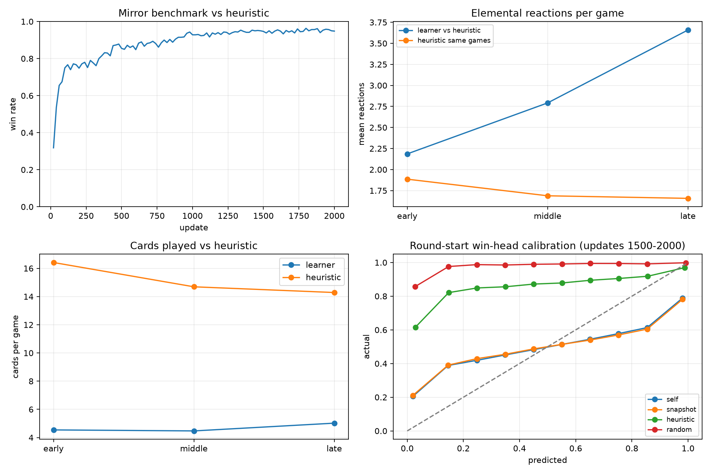
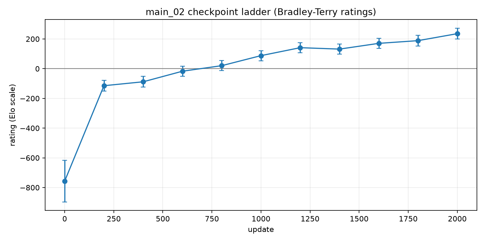
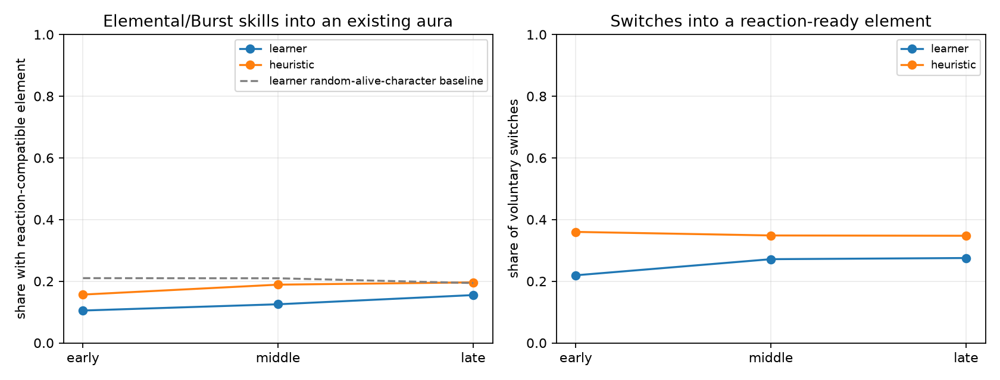
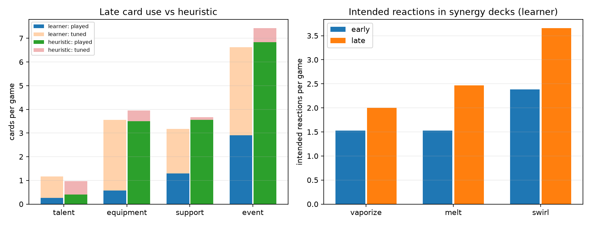
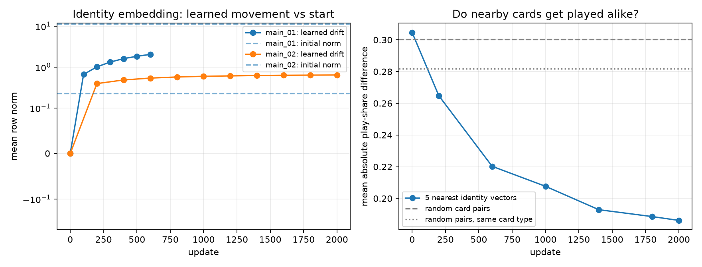
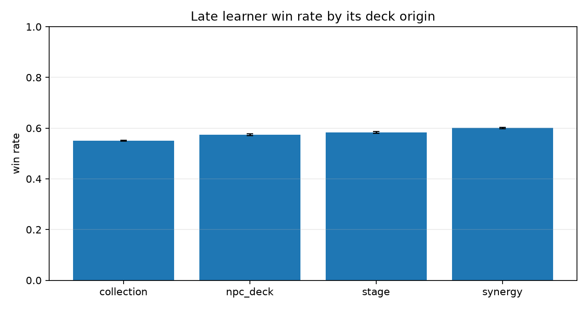

# Review of training run `runs/alpha_02`

*Written 2026-10-14. The analysis covers 1,029,794 training games, 86,013,070 recorded moves, all 100 mirror benchmarks, 3,200 full-state benchmark replays, 11 ladder checkpoints, and selected embedding checkpoints from the 401 saved weight files. Figures and reusable analysis code are listed at the end.*

## Plain-language summary

`alpha 2` is a real improvement over `alpha 1`, but it has not solved the two most important behavioural weaknesses.

1. **It is much stronger.** On exactly the same 600-game mirror benchmark, `alpha 1` final wins 80.3% [77.0%, 83.3%] against the heuristic and `alpha 2` final wins 94.8% [92.8%, 96.3%]. In a direct 600-game match, `alpha 2` beats `alpha 1` 83.2% [80.0%, 85.9%].
2. **Reaction use improved, but the evidence for deliberate setup is mixed.** Against the heuristic, learner reactions rise from 2.19 ± 0.03 early to 3.66 ± 0.03 late, while the heuristic falls from 1.89 to 1.66 in the same games. Vaporize, Melt and Swirl decks trigger more of their intended reactions. Full-state replays also show more switch-then-skill sequences into reaction-ready elements. However, only 15.5% of late Elemental Skill/Burst uses hit an already compatible aura, below the heuristic's 19.6% and below a random-alive-character counterfactual of 19.4%. The doubled total is therefore not proof that the whole increase is planned.
3. **Card play is still the clearest weakness.** Late against the heuristic, the learner plays 5.02 cards and tunes away 9.49 per game; the heuristic plays 14.29 and tunes 1.73. Total learner card play is slightly higher than early `alpha 2` (4.54) but lower than the 5.7 reported late in `alpha 1`. Talent handling did improve sharply: the learner now plays 21.9% of used talents, versus 4% in `alpha 1`.
4. **The small identity initialization worked.** In `alpha 2`, mean learned embedding drift reaches 0.640 from an initial mean norm of 0.226 (2.83 times the starting norm). In `alpha 1`, drift was only 2.04 against an initial norm of 11.29. At update 2,000, a card's five nearest learned neighbours differ in late play rate by 0.186 on average, versus 0.282 for random cards of the same broad type. Card identities learned behaviourally relevant structure.
5. **The plateau is gradual, not a hard stop at update 1,400.** The heuristic benchmark is effectively saturated around 1,300–1,400, but the checkpoint ladder continues to rise slowly. Update 2,000 is about 94 Elo above update 1,200 in the pooled ladder. Adjacent late comparisons remain noisy: update 1,800 and 2,000 split their 48 direct games 24–24.
6. **The separate win head is not calibrated.** In late self-play, predictions average 0.515 and outcomes 0.506, but the extremes are badly overconfident: predictions near 0.02 win 20.5%, and predictions near 0.98 win only 78.9%. It also remains opponent-blind: against the heuristic it predicts 0.830 and wins 0.925; against random it predicts 0.878 and wins 0.989. It is not safe for a concede rule without held-out, opponent-specific calibration.
7. **Invitation stages remain the hard real-use case.** When a collection deck faces an invitation deck controlled by the same late network, it wins 38.3% in Friendly Fracas and 33.0% in Serious Showdown. Synergy decks improve those rates to 51.3% and 45.6%, respectively. Knowing the opponent deck still has no measurable benefit.
8. **Most final benchmark losses look stochastic, but a smaller persistent core remains.** The final benchmark has 31 losses. Only 9 occur in fixed benchmark cells that lost at least half of the late evaluations; the other 22 usually won in nearby late checkpoints. This is consistent with policy/game randomness causing most isolated losses, while roughly one third point to repeatable matchup weaknesses.

## Data, comparisons and uncertainty

The SQLite export is `runs/alpha_02/games.sqlite` (9.3 GB). Existing files under `runs/` were treated as read-only; this database is a new, allowed export. The raw logs contain 1,029,794 games rather than the brief's approximate 920,000.

- Early/middle/late training windows in the database analyses are updates 1–200, 801–1,000 and 1,801–2,000. “Late” loss and calibration analyses use updates 1,500–2,000 where noted.
- Rate intervals are 95% Wilson intervals. Mean `±` values are normal-approximation 95% half-widths. The very large round-start calibration sample contains repeated observations from the same games, so its nominal bin uncertainty would be too optimistic; the report gives counts and error scores instead of narrow per-bin intervals.
- The exact `alpha 1` comparison rebuilds the trainer's collections and first 150 matchups from seed 12345, then plays both deck orders and both learner seats. `alpha 1` loads with `strict=False`; only its absent `win_head` parameters are missing.
- Behaviour in wins versus losses is correlational. Seat, deck order, benchmark matchup and most deck-knowledge assignments are randomized, so comparisons based directly on those assignments have a stronger causal interpretation.
- Full states exist only for the first four heuristic and four random matchups at each benchmark. Replay intent measures are conservative but not complete: character element plus current aura misses infusions, summons and some multi-step effects.
- These games use the project heuristic, random policy and trained networks—not HoYoverse's exact NPC decision policy. Results about “NPC mode” cannot prove behaviour against the live game's AI.
- GPU access was unavailable in this sandbox. Engine comparisons used CPU inference; the engine, decks, policies and sampling rules were otherwise unchanged.

## 1. Strength and the real plateau



### Same yardstick for `alpha 1` and `alpha 2`

| Evaluation | Wins | Games | Win rate (95% CI) | Mean rounds |
|---|---:|---:|---:|---:|
| `alpha 1` update 600 vs heuristic | 482 | 600 | 0.803 [0.770, 0.833] | 5.96 among wins |
| `alpha 2` update 2,000 vs heuristic | 569 | 600 | 0.948 [0.928, 0.963] | 5.49 among wins |
| `alpha 2` final vs `alpha 1` final | 499 | 600 | 0.832 [0.800, 0.859] | 5.38 overall |

There were no engine failures in either new comparison. The direct head-to-head is the strongest evidence that the gain is not merely benchmark specialization or a changed deck set.

### Checkpoint ladder



The ladder uses checkpoints every 200 updates. Every pair plays 12 fixed matchups in both deck orders and with each network in each seat: 48 games per pair, 2,640 games total. Ratings are a Bradley–Terry fit on an Elo scale with a Jeffreys half-win/half-loss correction, needed because update 0 was completely separated from trained checkpoints.

| Update | Rating | Approx. 95% half-width |
|---:|---:|---:|
| 0 | −757 | 140 |
| 400 | −88 | 36 |
| 800 | 20 | 34 |
| 1,000 | 88 | 34 |
| 1,200 | 141 | 34 |
| 1,400 | 132 | 34 |
| 1,600 | 171 | 35 |
| 1,800 | 189 | 35 |
| 2,000 | 236 | 37 |

The fast gains last through roughly update 1,200. After that, progress is slower and noisy rather than absent. Direct late pairs illustrate the uncertainty:

| Earlier → later | Later checkpoint wins | Games | Later win rate (95% CI) |
|---|---:|---:|---:|
| 1,200 → 2,000 | 32 | 48 | 0.667 [0.525, 0.783] |
| 1,400 → 2,000 | 36 | 48 | 0.750 [0.612, 0.851] |
| 1,800 → 2,000 | 24 | 48 | 0.500 [0.364, 0.636] |

Conclusion: the heuristic benchmark plateaus around 1,300 because it is near its ceiling. The internal policy continues improving on average, but there is no clear evidence of improvement in the final 200 updates alone.

## 2. Are elemental reactions deliberate?



### Total reactions

| Window | Learner, all games | Learner vs heuristic | Heuristic in those games |
|---|---:|---:|---:|
| Early | 2.164 ± 0.009 (n=141,213) | 2.186 ± 0.025 (n=18,145) | 1.886 ± 0.024 (n=18,145) |
| Middle | 2.689 ± 0.009 (n=162,130) | 2.792 ± 0.027 (n=20,929) | 1.688 ± 0.021 (n=20,929) |
| Late | 3.385 ± 0.010 (n=163,309) | 3.659 ± 0.028 (n=20,757) | 1.658 ± 0.021 (n=20,757) |

This increase is large, precise and specific to the learner. It is not explained by the heuristic reacting more in the same games.

### Do the named synergy decks produce their intended reactions?



For seats controlled by the learner and holding the named synergy deck:

| Archetype | Early intended reactions/game | Late intended reactions/game | Late all reactions/game | Late games |
|---|---:|---:|---:|---:|
| Vaporize | 1.528 ± 0.053 | 2.003 ± 0.052 | 2.227 ± 0.058 | 2,564 |
| Melt | 1.528 ± 0.047 | 2.464 ± 0.051 | 2.645 ± 0.055 | 2,587 |
| Swirl | 2.386 ± 0.077 | 3.654 ± 0.084 | 4.361 ± 0.092 | 2,482 |

All three intended reaction counts rise substantially. This says the decks are functioning more as designed, but it does not by itself identify which action caused each reaction or whether a summon made it automatically.

### Full-state intent checks

The replay analysis asks whether the chosen active character's Elemental Skill or Burst is compatible with the opponent active character's aura. Its chance comparison is the share of the learner's living characters whose element would have reacted with that aura.

| Measure | Early learner | Late learner | Late heuristic | Late random-alive-character baseline |
|---|---:|---:|---:|---:|
| Compatible Elemental Skill/Burst | 0.105 (539/5,136) | 0.155 (819/5,281) | 0.196 (312/1,590) | 0.194 |
| Switch enters reaction-ready element | 0.219 (396/1,806) | 0.275 (886/3,219) | 0.347 (181/521) | — |
| Reaction-ready switch followed by that character's skill | 0.253 (99/391) | 0.372 (326/876) | 0.089 (16/180) | — |

The last row is positive evidence of learned sequencing: once the learner switches into a reaction-ready element, it follows with that character's skill much more often than early and much more often than the heuristic. The first row is contrary evidence: at the actual moment of skill use, the learner is still no better than a random living-character counterfactual and remains below the heuristic.

**Conclusion:** `alpha 2` learned some deliberate reaction setup sequences, especially switch-then-skill patterns and synergy-deck execution. The data do not support the stronger claim that most of the doubled reaction count is deliberate. Delayed summons, deck composition, survival and incidental aura contact remain plausible contributors.

## 3. Card play versus elemental tuning

Against the heuristic:

| Window/controller | Cards played/game | Tuned/game |
|---|---:|---:|
| Early learner | 4.54 | 11.86 |
| Middle learner | 4.47 | 10.60 |
| Late learner | 5.02 | 9.49 |
| Late heuristic | 14.29 | 1.73 |

Late category detail (20,757 games):

| Category | Learner played | Learner tuned | Learner share played | Heuristic share played |
|---|---:|---:|---:|---:|
| Talent | 0.25 | 0.91 | **0.219** (24,157 uses) | 0.411 |
| Equipment | 0.57 | 2.99 | **0.159** (73,817) | 0.886 |
| Support | 1.30 | 1.88 | **0.409** (65,854) | 0.969 |
| Event | 2.91 | 3.72 | **0.439** (137,429) | 0.920 |

The small embedding initialization helped the narrow talent failure: talent play share rose from 4% in the `alpha 1` report to 21.9%. It did not solve card use overall. The learner still converts most equipment, supports and events to dice and plays about one third as many cards as the heuristic. Total late card play (5.02) is also below `alpha 1`'s reported 5.7, although games and deck mixes differ, so this is not a controlled run-to-run causal estimate.

## 4. Did identity embeddings learn?



| Run/checkpoint | Mean initial embedding norm | Mean learned drift | Drift / initial norm |
|---|---:|---:|---:|
| `alpha 1`, update 600 | 11.293 | 2.043 | 0.181 |
| `alpha 2`, update 200 | 0.226 | 0.395 | 1.748 |
| `alpha 2`, update 1,000 | 0.226 | 0.595 | 2.632 |
| `alpha 2`, update 2,000 | 0.226 | 0.640 | 2.832 |

The intended change worked: learned movement dominates the random start by update 200, rather than remaining a small perturbation after 600 updates.

For 534 cards with at least 100 late learner play/tune decisions, the mean absolute difference in play share between each card and its five nearest identity vectors changes as follows:

| Update | Nearest-neighbour play-share difference | Random card pairs | Random pairs of same broad card type |
|---:|---:|---:|---:|
| 0 | 0.305 | 0.300 | 0.282 |
| 600 | 0.220 | 0.300 | 0.282 |
| 1,400 | 0.193 | 0.300 | 0.282 |
| 2,000 | **0.186** | 0.300 | 0.282 |

At initialization there is no useful neighbourhood structure. By update 2,000, nearest cards are 34% more similar in play rate than random cards of the same broad category. This is strong evidence that card identities learned behaviourally relevant similarity. It is an association, not proof that embedding geometry caused the policy's decisions.

## 5. Win-chance calibration

The following uses the first learner action in every round, updates 1,500–2,000:

| Opponent | Round starts | Mean predicted | Actual win rate | Brier | 10-bin calibration error |
|---|---:|---:|---:|---:|---:|
| All | 2,401,089 | 0.565 | 0.572 | 0.205 | 0.164 |
| Self | 1,491,189 | 0.515 | 0.506 | 0.221 | 0.178 |
| Snapshot | 541,033 | 0.515 | 0.506 | 0.225 | 0.184 |
| Heuristic | 292,182 | 0.830 | 0.925 | 0.113 | 0.121 |
| Random | 76,685 | 0.878 | 0.989 | 0.080 | 0.111 |

The overall average looks reasonable only because errors cancel. In late self-play:

- predictions averaging 0.020 win 0.205 (479,201 round starts);
- predictions averaging 0.980 win 0.789 (520,720);
- the middle is also compressed toward 50% in the outcomes.

The separate head therefore ranks broad game states but emits probabilities that are far too extreme. Its opponent blindness is unchanged: it substantially underpredicts results against the heuristic and random play. Unlike the old value head, this output estimates the right target (plain win/loss), but it did not achieve the intended calibration.

## 6. Where it still loses



### Deck origins and synergy archetypes

Across all late learner seats (updates 1,500–2,000), including self-play:

| Learner deck origin | Win rate (95% CI) | Seats |
|---|---:|---:|
| Collection | 0.550 [0.547, 0.552] | 156,641 |
| NPC deck | 0.573 [0.570, 0.577] | 75,093 |
| Stage deck | 0.584 [0.581, 0.587] | 81,406 |
| Synergy deck | 0.600 [0.597, 0.603] | 95,561 |

The weakest hand-built archetypes are mono Electro (0.143, n=1,579), mono Dendro (0.199, n=1,514), mono Cryo (0.361, n=1,581), Nightsoul (0.368, n=1,555), mono Anemo (0.394, n=1,621), and mono Geo (0.403, n=1,567). Among explicit reaction decks, Overloaded is 0.441 (n=6,303), Vaporize 0.454 (n=6,474), Hyperbloom 0.479 (n=1,565), Burgeon 0.522 (n=1,639), Freeze 0.538 (n=6,308) and Melt 0.545 (n=6,415). These are mixed-opponent correlations; they rank where to inspect, not intrinsic deck strength.

### Invitation stages and deck knowledge

When the stage deck is controlled by the same late network (`self` games), the player-side results are:

| Stage | Collection player deck | Synergy player deck |
|---|---:|---:|
| Invitation Friendly | 0.383 [0.375, 0.391] (n=14,929) | 0.513 [0.505, 0.521] (n=14,793) |
| Invitation Serious | **0.330 [0.317, 0.343]** (n=4,983) | **0.456 [0.442, 0.470]** (n=4,941) |

Against the weaker heuristic controlling the same stage side, these rise to 89.9–94.8%. The remaining real-use weakness is therefore coherent invitation decks played competently, not merely the stage definitions themselves.

Knowing the deck still does not help. Across all late learner seats, known mode wins 0.571 (n=228,195) and blind mode 0.575 (n=180,506). Within invitation stages the pattern is equally flat or slightly reversed: Friendly 0.526 known versus 0.532 blind; Serious 0.479 known versus 0.489 blind. Random assignment supports a causal reading: the current policy is not extracting useful value from the extra deck information.

### What the heuristic does when it wins

The heuristic wins only 3,299 of 52,633 late games. Per round:

| Heuristic action | In heuristic wins | In heuristic losses |
|---|---:|---:|
| Bursts | **0.303** | 0.184 |
| Elemental Skills | **0.651** | 0.617 |
| Events | **1.447** | 1.219 |
| Talents | **0.105** | 0.071 |
| Equipment | 0.509 | 0.641 |
| Voluntary switches | 0.219 | 0.236 |

The largest separation is Burst use, followed by events and talents. This is correlational: winning preserves characters, energy and useful hands, so these actions can be consequences rather than causes. It does identify the surviving-loss replay pattern to inspect: the heuristic converts its extra turns into Bursts and immediate event value.

### Randomness versus repeatable weakness

At update 2,000 the heuristic benchmark loses 31 of 600 games. Looking at the same matchup/deck-order/seat cell over updates 1,800–2,000:

- only 9 of the 31 final-loss cells lose at least half of those late evaluations;
- the 31 cells' mean prior late learner win rate is 0.622;
- 22 losses occur in cells that usually win.

Thus most individual final losses are consistent with stochastic play or game randomness. The nine repeatedly poor cells are better candidates for matchup-specific policy failures. This is not a decomposition of exact RNG causality—the stochastic policy itself and the engine both vary—but it prevents treating every one-off loss as a learned weakness.

## 7. Other important findings

- **The run did not merely overfit the heuristic.** The final network wins 83.2% head-to-head against `alpha 1`, and the all-checkpoint ladder rises after the heuristic benchmark saturates.
- **Reaction learning and card learning diverged.** Identity embeddings acquired meaningful card geometry, and talent play improved, but the action policy still prefers immediate dice and skill damage over most card investment.
- **Late self and snapshot outcomes are almost identical** (both 0.506 actual at round starts), consistent with the reported convergence against recent snapshots.
- **Winning lines are shorter, consistent with the speed reward's goal.** The exact `alpha 1` benchmark averages 5.96 rounds among wins; the `alpha 2` final benchmark averages 5.49. Reward and policy changes landed together, so this does not isolate the reward as the cause.

## Suggestions for the next training step

These are proposals, not measurements.

1. **Suggestion—prioritize card credit assignment before simply enlarging the network.** The embeddings now distinguish cards, so representation is no longer the main bottleneck. Run a short controlled diagnostic with an auxiliary card-value target, card-play curriculum, or higher sampling of delayed-value equipment/support states. Compare against an otherwise identical seed set. Do not add a permanent card-play reward; that could reward bad cards.
2. **Suggestion—log reactions per action before adding a reaction reward.** Record which action/event caused each reaction and the pre-action aura. The current evidence shows some planned sequences but not enough to justify rewarding every reaction. If shaping is tested, use a small diagnostic bonus that decays to zero and judge final win rate, not reaction count.
3. **Suggestion—continue the invitation curriculum with competent opponents.** Oversample collection and synergy player decks against Friendly/Serious stage decks controlled by current or strong snapshot networks. The heuristic version is already nearly solved and contributes little useful pressure.
4. **Suggestion—do not deploy the win head for conceding yet.** Fit calibration only on locked held-out games, separately by opponent family. If the production player knows the opponent family, provide that identity to the calibration layer or model. Track Brier score and calibration error as training metrics.
5. **Suggestion—make the next comparison controlled and held out.** Keep a locked deck/collection family set unseen during training. Evaluate the current 1.23M model against one change at a time: larger network, card auxiliary task, or matchup curriculum.
6. **Suggestion—keep the ladder, but spend more games near the suspected plateau.** The all-pairs ladder is useful, while 48 direct games leave ±13–14 point intervals. Use fewer distant pairs and at least 120–200 games for adjacent late checkpoints.
7. **Suggestion—retain the small embedding initialization.** It achieved its stated goal and produced measurable behaviour-aligned card neighbourhoods.

## Reproduction and files

Run with the project environment:

```sh
.venv/bin/python scripts/training/export_games.py --run runs/alpha_02
.venv/bin/python experiments/early_run_reviews/review_alpha_2_statistics.py
.venv/bin/python experiments/early_run_reviews/review_reaction_intent.py
.venv/bin/python experiments/early_run_reviews/review_embeddings.py
.venv/bin/python experiments/early_run_reviews/review_checkpoint_ladder.py --workers 10 --ladder-matchups 12
```

Generated analysis data are in `data/derived/main_02_*.json` (gitignored). The report figures are in `figures/alpha_2/`.
